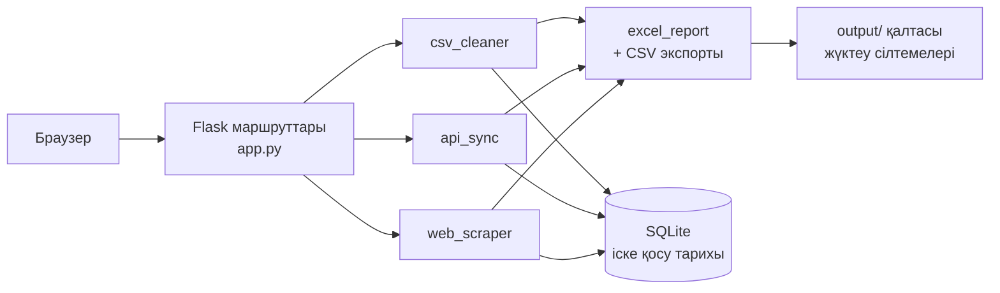

<div align="center">

# 🎛️ Automation Control Center

**Жергілікті веб-панель: CSV файлдарын тазалайды, API деректерін синхрондайды, сайттан тауарларды жинайды және әр іске қосудың тарихын сақтайды.**

[](https://github.com/artyom129/automation-control-center-web/actions/workflows/tests.yml)


**🌐 Тіл:** [English](README.md) · [Русский](README.ru.md) · **Қазақша**

</div>

---

## 📌 Не үшін қажет

Шағын командалар бір рутинаны қолмен қайта-қайта жасайды: қисық CSV шығарындыларын түзетеді, API-дан жазбаларды алады, сайттардан тауар деректерін жинайды. Әр тапсырма жеке скриптте тұрады, оның қашан іске қосылғанын және не бергенін ешкім есте сақтамайды. Бұл жоба осындай үш тапсырманы бір жергілікті веб-бетке жинайды, әр іске қосу үшін CSV және Excel жасайды және іске қосуды SQLite-қа жазады, сонда оны кейін табуға болады.

## ✨ Не істейді

| | Құрал | Не болады |
|---|---|---|
| 🧹 | **CSV Cleaner** | Файлды жүктеңіз немесе кірістірілген үлгіні іске қосыңыз. Баған атаулары бір пішімге келтіріледі, мәтін қиылады, аттар мен қалалар бас әріппен жазылады, email кіші әріпке ауыстырылады, тек `id` өзгеше болса да қайталанған жолдар жойылады, ал email-і қате жолдар себебімен бөлек қойылады |
| 🔌 | **API Data** | REST API-дан пайдаланушыларды жүктейді, қалыпқа келтіреді, қайталанған email мен идентификаторларды қабылдамайды және қабылданбаған жазбаның барлық мәселесін тізіп көрсетеді |
| 🕷️ | **Website Scraper** | Демо-каталогтың бірден беске дейінгі бетін аралайды, әр беттегі тауар сілтемелерін дұрыс құрады және қайталануларды алып тастайды |
| 🗂️ | **Іске қосу тарихы** | Әр іске қосу күйімен, жазбалар санымен және егжей-тегжейімен SQLite-та сақталады. Басты бетте қорытындылар мен соңғы іске қосулар көрінеді |
| 📥 | **Экспорт** | Әр құрал CSV және пішімделген Excel жасайды (диаграммасы бар қорытынды парағы, таза жазбалар, жарамсыз жазбалар) |
| 🌍 | **Екі тіл** | Интерфейс ағылшын және орыс тілдерінде, бүйір панельде ауыстырылады |
| 🌗 | **Ашық және қараңғы тақырып** | Жүйе тақырыбын ұстанады |

## 🔄 Қалай құрылған



## 🚀 Жылдам бастау

```bash
git clone https://github.com/artyom129/automation-control-center-web.git
cd automation-control-center-web/automation_control_center_web
python -m venv .venv
```

Ортаны іске қосыңыз:

```bash
# Windows
.venv\Scripts\activate

# macOS / Linux
source .venv/bin/activate
```

Тәуелділіктерді орнатып, қосымшаны іске қосыңыз:

```bash
pip install -r requirements.txt
python app.py
```

Браузерде http://127.0.0.1:5000 мекенжайын ашыңыз. CSV Cleaner бетінде **Run sample** батырмасын басыңыз, сонда ештеңе жүктемей-ақ толық нәтижені көресіз.

## ⚙️ Баптау

| Айнымалы | Не істейді | Әдепкі мәні |
|---|---|---|
| `SECRET_KEY` | Тілді есте сақтайтын сессия cookie-сіне қол қояды. Қайта іске қосқаннан кейін тіл сақталсын десеңіз, оны орнатыңыз | әр іске қосуда кездейсоқ |
| `FLASK_DEBUG` | `1` мәні Flask жөндеу режимін қосады. Ол интерактивті консольді ашады, сондықтан оны тек өз компьютеріңізде қосыңыз | өшірулі |

Жүктеу көлемі 5 МБ-пен шектелген, файл UTF-8 кодтауындағы CSV болуы керек. Басқа жағдайда пайдаланушы қате трассасын емес, түсінікті хабарлама алады.

## 📤 Қандай файлдар жасалады

Барлық файлдар `automation_control_center_web/output/` қалтасына түседі, оны git елемейді.

| Файл | Кім жасайды |
|---|---|
| `cleaned_data.csv`, `cleaned_data_report.xlsx` | CSV Cleaner |
| `api_sync_records.csv`, `api_sync_report.xlsx` | API Data |
| `scraped_products.csv`, `scraped_products_report.xlsx` | Website Scraper |
| `automation_center.db` | Іске қосу тарихы және әр таза жазбаның JSON көшірмесі |

## 🧪 Тесттер

```bash
cd automation_control_center_web
python -m pytest -q
```

42 тест желісіз жұмыс істейді. Олар барлық беттерді, тілді ауыстыруды, жүктеулерді тексеруді (қате кеңейтім, бос файл, қате кодтау, тым үлкен файл), тазалау ережелерін, API деректерін қалыпқа келтіруді, парсердің беттерді аралауы мен шеңберден қорғауын, SQLite тарихын, Excel файлының мазмұнын және файлдарды жүктеп алуды, оның ішінде output қалтасынан тыс файлды оқу әрекетін қамтиды. CI оларды Python 3.11 және 3.12 нұсқаларында іске қосады.

<details>
<summary>🐛 Осы нұсқада табылып, түзетілген мәселелер</summary>

<br>

- **Қосымша беттердің көбінде құлап қалатын.** Репозиторийде жеті шаблон жетіспеді (`dashboard`, `scraper`, `history`, `help` және үш қосалқы шаблон), сондықтан `/`, `/scraper`, `/history` және `/help` беттері `TemplateNotFound` қатесін беретін. Енді олар жазылды, ал тест әр бетті ашады.
- **Үлгі деректер қайталануды көрсетпейтін.** 4-жол 1-жолды басқа `id`-мен қайталайды, бірақ қайталануларды барлық бағандар, соның ішінде `id` бойынша салыстыратын. Енді `id` ескерілмейді, үлгіде дәл бір қайталану табылады.
- **Деректерде «None» сөзі.** API-дағы жоқ өріс `None` мәтініне айналатын. Енді бос мәндер бос күйінде қалады.
- **База жолы қосымша қайдан іске қосылғанына байланысты болды.** Ол салыстырмалы еді. Енді база кодтың жанында тұрады.
- **Жазбалар Python repr күйінде сақталды.** Мәтін JSON-ға ұқсайтын, бірақ оқылмайтын. Енді жазбалар нағыз JSON ретінде сақталады.
- **Байланыстар жабылмайтын**, сондықтан Windows-та SQLite файлы құлыптаулы қалатын.
- **Жөндеу режимі әрдайым қосулы, құпия кілт кодта жазылған еді.** Енді жөндеу тек сұралғанда қосылады, ал кілт ортадан алынады.
- **Жүктелген файлдар келушінің файл атауымен дискіге жазылатын.** Енді файл тікелей сұраудан оқылады, ештеңе жазылмайды.
- **Бағаларда `£` орнына `£`**, кодтау қате болжанғандықтан. Енді кодтау беттің өзінен оқылады.

</details>

## 📂 Жоба құрылымы

```text
.
├── .github/workflows/tests.yml
└── automation_control_center_web/
    ├── app.py                    # маршруттар, аудармалар, жүктеулерді өңдеу
    ├── modules/
    │   ├── csv_cleaner.py
    │   ├── api_sync.py
    │   ├── web_scraper.py
    │   ├── excel_report.py
    │   └── database.py
    ├── templates/                # беттер мен қосалқы шаблондар
    ├── static/style.css
    ├── sample_data/sample_customers.csv
    ├── tests/
    └── requirements.txt
```

## 🧰 Технологиялар

Python · Flask · pandas · SQLite · openpyxl · requests · BeautifulSoup · pytest · GitHub Actions

---

<div align="center">

*[Artyom Koncha](https://github.com/artyom129) жасаған жеке портфолио жобасы: шағын веб-интерфейсі бар практикалық Python автоматтандыруы.*

</div>
