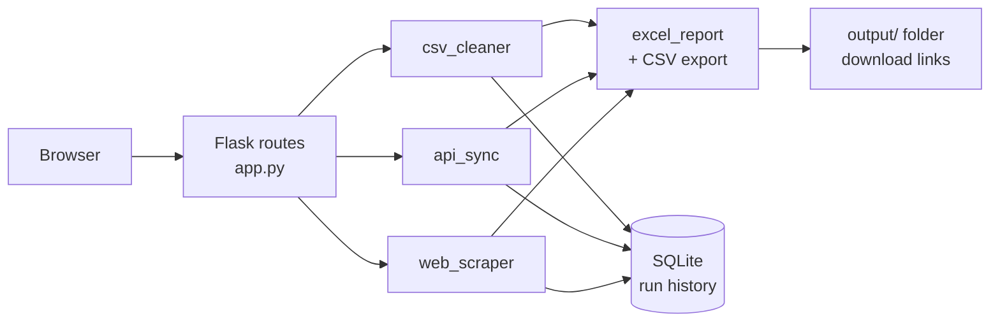

<div align="center">

# 🎛️ Automation Control Center

**A local web dashboard that cleans CSV files, syncs API data, scrapes product listings, and keeps a history of every run.**

[](https://github.com/artyom129/automation-control-center-web/actions/workflows/tests.yml)


**🌐 Language:** **English** · [Русский](README.ru.md) · [Қазақша](README.kk.md)

</div>

---

## 📌 Why this exists

Small teams keep running the same chores by hand: fixing messy CSV exports, pulling records from an API, collecting product data from a website. Each chore is a script somewhere, and nobody remembers when it last ran or what it produced. This project puts three of those chores behind one local web page, writes CSV and Excel files for every run, and records the run in SQLite so you can look it up later.

## ✨ What it does

| | Tool | What happens |
|---|---|---|
| 🧹 | **CSV Cleaner** | Upload a file or run the bundled sample. Column names are normalized, text is trimmed, names and cities are title-cased, emails are lower-cased, duplicate rows are removed even when only the `id` differs, and rows with a broken email are set aside with the reason |
| 🔌 | **API Data** | Loads users from a REST API, normalizes them, rejects duplicate emails and ids, and lists every problem of a rejected record |
| 🕷️ | **Website Scraper** | Walks one to five pages of a demo catalog, resolves product links correctly on every page, and drops duplicates |
| 🗂️ | **Run history** | Every run is stored in SQLite with its status, record count, and details. The overview shows totals and the latest runs |
| 📥 | **Exports** | Each tool produces a CSV and a formatted Excel workbook (dashboard sheet with a chart, clean records, invalid records) |
| 🌍 | **Two languages** | Interface in English and Russian, switched in the sidebar |
| 🌗 | **Light and dark** | Follows the system theme |

## 🔄 How it fits together



## 🚀 Quick start

```bash
git clone https://github.com/artyom129/automation-control-center-web.git
cd automation-control-center-web/automation_control_center_web
python -m venv .venv
```

Activate the environment:

```bash
# Windows
.venv\Scripts\activate

# macOS / Linux
source .venv/bin/activate
```

Install the dependencies and start the app:

```bash
pip install -r requirements.txt
python app.py
```

Open http://127.0.0.1:5000 in a browser. Press **Run sample** on the CSV Cleaner page to see a full result without uploading anything.

## ⚙️ Configuration

| Variable | Effect | Default |
|---|---|---|
| `SECRET_KEY` | Signs the session cookie that remembers the language. Set it if you want the language to survive a restart | random on every start |
| `FLASK_DEBUG` | Set to `1` to turn on Flask debug mode. It exposes an interactive console, so keep it off anywhere other than your own machine | off |

Uploads are limited to 5 MB and must be UTF-8 CSV files. Anything else gets a plain message instead of a stack trace.

## 📤 What gets written

All files go to `automation_control_center_web/output/`, which is ignored by git.

| File | Created by |
|---|---|
| `cleaned_data.csv`, `cleaned_data_report.xlsx` | CSV Cleaner |
| `api_sync_records.csv`, `api_sync_report.xlsx` | API Data |
| `scraped_products.csv`, `scraped_products_report.xlsx` | Website Scraper |
| `automation_center.db` | Run history and a JSON copy of every clean record |

## 🧪 Tests

```bash
cd automation_control_center_web
python -m pytest -q
```

42 tests run without a network. They cover every page, the language switch, upload validation (wrong extension, empty file, wrong encoding, oversized file), the cleaning rules, API normalization, scraper pagination and loop protection, the SQLite history, the Excel workbook contents, and file downloads, including an attempt to read a file outside the output folder. CI runs them on Python 3.11 and 3.12.

<details>
<summary>🐛 Problems found and fixed in this version</summary>

<br>

- **The app crashed on most pages.** The repository was missing seven templates (`dashboard`, `scraper`, `history`, `help`, and three partials), so `/`, `/scraper`, `/history` and `/help` raised `TemplateNotFound`. They are written now, and a test opens every page.
- **The sample data did not show a duplicate.** Row 4 of the sample repeats row 1 under a new `id`, but duplicates were compared across all columns including `id`. The `id` column is now ignored, and the sample reports exactly one duplicate.
- **The word "None" in the data.** A missing API field became the text `None`. Missing values are now empty.
- **Database path depended on where you started the app.** It was relative to the working directory. It now lives next to the code.
- **Records were stored as a Python repr.** The text looked like JSON but was not parseable. Records are now stored as real JSON.
- **Connections were never closed**, which keeps the SQLite file locked on Windows.
- **Debug mode was always on, and the secret key was written into the code.** Debug is now opt-in and the key comes from the environment.
- **Uploads were saved to disk under the visitor's file name.** The file is now read straight from the request and nothing is written.
- **`£` instead of `£` in scraped prices**, caused by a wrong charset guess. Fixed by reading the charset from the page.

</details>

## 📂 Project layout

```text
.
├── .github/workflows/tests.yml
└── automation_control_center_web/
    ├── app.py                    # routes, translations, upload handling
    ├── modules/
    │   ├── csv_cleaner.py
    │   ├── api_sync.py
    │   ├── web_scraper.py
    │   ├── excel_report.py
    │   └── database.py
    ├── templates/                # pages and partials
    ├── static/style.css
    ├── sample_data/sample_customers.csv
    ├── tests/
    └── requirements.txt
```

## 🧰 Tech stack

Python · Flask · pandas · SQLite · openpyxl · requests · BeautifulSoup · pytest · GitHub Actions

---

<div align="center">

*A personal portfolio project by [Artyom Koncha](https://github.com/artyom129): practical Python automation with a small web interface.*

</div>
