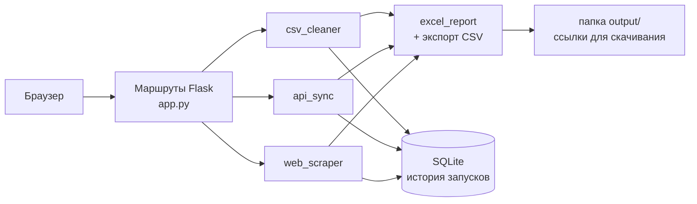

<div align="center">

# 🎛️ Automation Control Center

**Локальная веб-панель: чистит CSV-файлы, синхронизирует данные из API, собирает товары с сайта и хранит историю каждого запуска.**

[](https://github.com/artyom129/automation-control-center-web/actions/workflows/tests.yml)


**🌐 Язык:** [English](README.md) · **Русский** · [Қазақша](README.kk.md)

</div>

---

## 📌 Зачем это нужно

Небольшие команды постоянно делают одну и ту же рутину вручную: исправляют кривые CSV-выгрузки, забирают записи из API, собирают данные о товарах с сайтов. Каждая такая задача живёт в отдельном скрипте, и никто не помнит, когда он запускался и что выдал. Этот проект собирает три такие задачи на одной локальной веб-странице, создаёт CSV и Excel для каждого запуска и записывает запуск в SQLite, чтобы его можно было найти позже.

## ✨ Что он делает

| | Инструмент | Что происходит |
|---|---|---|
| 🧹 | **CSV Cleaner** | Загрузите файл или запустите встроенный пример. Названия колонок приводятся к единому виду, текст обрезается, имена и города пишутся с заглавной, email переводится в нижний регистр, дубликаты строк удаляются, даже если отличается только `id`, а строки с неверным email откладываются с указанием причины |
| 🔌 | **API Data** | Загружает пользователей из REST API, нормализует их, отклоняет дубликаты email и идентификаторов и перечисляет все проблемы отклонённой записи |
| 🕷️ | **Website Scraper** | Обходит от одной до пяти страниц демо-каталога, правильно строит ссылки на товары на каждой странице и убирает дубликаты |
| 🗂️ | **История запусков** | Каждый запуск сохраняется в SQLite со статусом, числом записей и деталями. На главной видны итоги и последние запуски |
| 📥 | **Экспорт** | Каждый инструмент создаёт CSV и отформатированный Excel (лист с итогами и диаграммой, чистые записи, невалидные записи) |
| 🌍 | **Два языка** | Интерфейс на английском и русском, переключается в боковой панели |
| 🌗 | **Светлая и тёмная тема** | Следует системной теме |

## 🔄 Как это устроено



## 🚀 Быстрый старт

```bash
git clone https://github.com/artyom129/automation-control-center-web.git
cd automation-control-center-web/automation_control_center_web
python -m venv .venv
```

Активируйте окружение:

```bash
# Windows
.venv\Scripts\activate

# macOS / Linux
source .venv/bin/activate
```

Установите зависимости и запустите приложение:

```bash
pip install -r requirements.txt
python app.py
```

Откройте http://127.0.0.1:5000 в браузере. На странице CSV Cleaner нажмите **Run sample** (в русском интерфейсе «Запустить тестовый пример»), чтобы увидеть полный результат без загрузки файлов.

## ⚙️ Настройка

| Переменная | Что делает | По умолчанию |
|---|---|---|
| `SECRET_KEY` | Подписывает cookie сессии, в которой хранится язык. Задайте её, если хотите сохранять язык после перезапуска | случайный при каждом запуске |
| `FLASK_DEBUG` | Значение `1` включает режим отладки Flask. Он открывает интерактивную консоль, поэтому включайте его только на своём компьютере | выключено |

Загрузки ограничены 5 МБ и должны быть CSV-файлами в кодировке UTF-8. В остальных случаях пользователь получает понятное сообщение, а не трассировку ошибки.

## 📤 Какие файлы создаются

Все файлы попадают в `automation_control_center_web/output/`, эта папка игнорируется git.

| Файл | Кто создаёт |
|---|---|
| `cleaned_data.csv`, `cleaned_data_report.xlsx` | CSV Cleaner |
| `api_sync_records.csv`, `api_sync_report.xlsx` | API Data |
| `scraped_products.csv`, `scraped_products_report.xlsx` | Website Scraper |
| `automation_center.db` | История запусков и JSON-копия каждой чистой записи |

## 🧪 Тесты

```bash
cd automation_control_center_web
python -m pytest -q
```

42 теста работают без сети. Они проверяют все страницы, переключение языка, проверку загрузок (неверное расширение, пустой файл, неверная кодировка, слишком большой файл), правила очистки, нормализацию данных API, пагинацию парсера и защиту от циклов, историю в SQLite, содержимое Excel-файла и скачивание файлов, включая попытку прочитать файл вне папки output. CI запускает их на Python 3.11 и 3.12.

<details>
<summary>🐛 Проблемы, найденные и исправленные в этой версии</summary>

<br>

- **Приложение падало почти на всех страницах.** В репозитории не хватало семи шаблонов (`dashboard`, `scraper`, `history`, `help` и трёх частичных), поэтому `/`, `/scraper`, `/history` и `/help` выдавали `TemplateNotFound`. Теперь они написаны, а тест открывает каждую страницу.
- **Пример данных не показывал дубликат.** Строка 4 повторяет строку 1 с другим `id`, но дубликаты сравнивались по всем колонкам, включая `id`. Теперь `id` игнорируется, и в примере находится ровно один дубликат.
- **Слово «None» в данных.** Отсутствующее поле API превращалось в текст `None`. Теперь пропуски пустые.
- **Путь к базе зависел от того, откуда запущено приложение.** Он был относительным. Теперь база лежит рядом с кодом.
- **Записи сохранялись как repr Python.** Текст выглядел как JSON, но не разбирался. Теперь записи хранятся как настоящий JSON.
- **Соединения не закрывались**, из-за чего файл SQLite оставался заблокированным в Windows.
- **Режим отладки был всегда включён, а секретный ключ записан в коде.** Теперь отладка включается явно, а ключ берётся из окружения.
- **Загруженные файлы сохранялись на диск под именем посетителя.** Теперь файл читается прямо из запроса, ничего не записывается.
- **`£` вместо `£` в ценах**, из-за неверно угаданной кодировки. Теперь кодировка читается из самой страницы.

</details>

## 📂 Структура проекта

```text
.
├── .github/workflows/tests.yml
└── automation_control_center_web/
    ├── app.py                    # маршруты, переводы, обработка загрузок
    ├── modules/
    │   ├── csv_cleaner.py
    │   ├── api_sync.py
    │   ├── web_scraper.py
    │   ├── excel_report.py
    │   └── database.py
    ├── templates/                # страницы и частичные шаблоны
    ├── static/style.css
    ├── sample_data/sample_customers.csv
    ├── tests/
    └── requirements.txt
```

## 🧰 Технологии

Python · Flask · pandas · SQLite · openpyxl · requests · BeautifulSoup · pytest · GitHub Actions

---

<div align="center">

*Личный портфолио-проект [Artyom Koncha](https://github.com/artyom129): практическая автоматизация на Python с небольшим веб-интерфейсом.*

</div>
